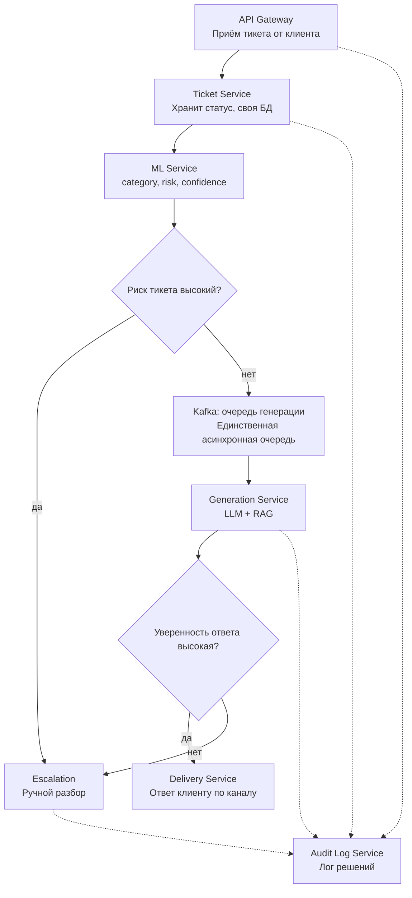
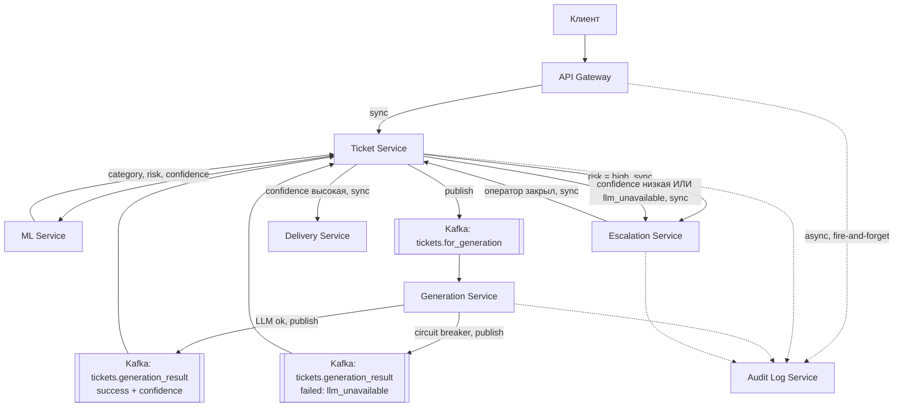
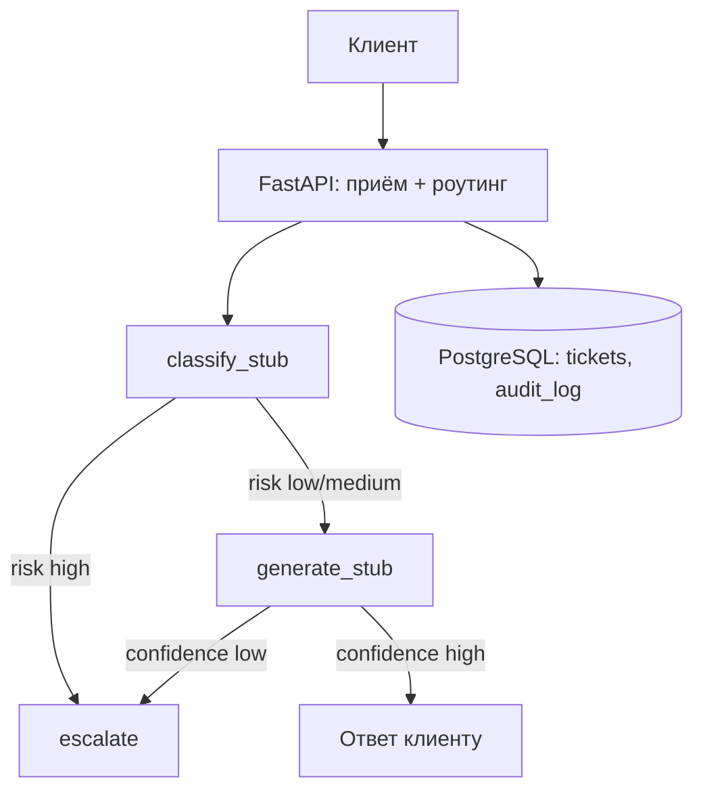

# Архитектура (черновик)

С фронта (веб/приложение) вместе с текстом тикета приходит поле «категория проблемы» — пользователь сам указывает, к чему относится обращение (оплата, доставка, аккаунт и т.п.). Это дополнительный признак на входе классификатора, наравне с текстом тикета, а не замена самой классификации: финальную категорию и риск определяет модель и они могут отличаться от значения, указанного пользователем.

---

---

# Архитектура: система обработки тикетов поддержки

## Диаграмма

## Сервисы

| Сервис | Отвечает за | Sync/Async |
|---|---|---|
| API Gateway | Приём тикета, idempotency-ключ, канал | Sync |
| Ticket Service | Статус тикета, вся логика роутинга | Sync + consumer |
| ML Service | Классификация: L0 rule-matcher → L1 (E5-large + CatBoost) → L2 (FAISS, детект массовых инцидентов) → L3 (LLM/оператор) | Sync |
| Generation Service | Генерация ответа: LLM + RAG (чёрный ящик) | Async, consumer |
| Escalation Service | Очередь оператора | Sync |
| Delivery Service | Доставка ответа по каналу | Sync |
| Audit Log Service | Лог решений всех сервисов | Async, fire-and-forget |

## Базы данных

| Сервис | БД |
|---|---|
| Ticket Service | PostgreSQL `tickets` |
| Escalation Service | PostgreSQL `operator_queue` |
| Audit Log Service | PostgreSQL/ClickHouse `audit_log` |
| ML Service | FAISS (векторный индекс) + Redis (`incident_mode_active`) |
| Gateway, Generation, Delivery | нет (stateless) |

Каждый сервис — единственный владелец своей БД.

## ML: инфраструктура и данные

Классификация устроена как каскад уровней, чтобы держать баланс скорости и стоимости:

- **L0 — Rule Matcher.** Regex по подстрокам, без внешней инфраструктуры, только код. Ловит ~40% тикетов с confidence 0.98+.
- **L1 — E5-large + CatBoost.** Один forward энкодера E5-large даёт эмбеддинг, который используется и для L1 (классификация через CatBoost), и для L2 (поиск). CatBoost — CPU-инференс, <100 мс, калиброванный confidence решает маршрут (LLM vs человек, порог ~60%).
- **L2 — FAISS + временное окно.** Тот же эмбеддинг ищет похожие тикеты той же категории в окне времени T (по умолчанию 10 мин); если похожих тикетов больше Q (по умолчанию 50) — фиксируется массовый инцидент.
- **L3 — LLM API / оператор.** Для low-confidence случаев и генерации ответа.

**Нужная инфраструктура:**
- Сервис инференса эмбеддингов (E5-large), CPU достаточно для baseline
- CatBoost-классификатор, лёгкий, отдельно от энкодера не хранит состояние
- **FAISS-индекс** — векторное хранилище с TTL 24 часа для L2 (скользящее окно, ~200k векторов), плюс постоянный индекс для L1/L3 semantic search по решённым тикетам
- **Redis** — флаг `incident_mode_active` для заморозки авто-ответов на время инцидента
- **PostgreSQL** (та же БД тикетов или реплика) — источник resolved-тикетов и operator labels для ежедневного дообучения
- **Presidio** — PII-редакция тикетов перед использованием как обучающих данных
- **PagerDuty/Slack** — алерт дежурному при обнаружении массового инцидента
- **Grafana** — метрики L2: detection rate, false positive rate, time to detect, latency FAISS-поиска

Холодный старт (нет размеченной базы) закрывается L0-правилами и LLM zero-shot до накопления 500+ размеченных тикетов — ML-классификатор (L1) подключается только после этого порога.

## Observability

- **Технические:** RPS, latency p95 (<500 мс на горячем пути), consumer lag у Generation Service, глубина operator_queue
- **ML:** confidence по категориям, доля эскалаций по причине (risk / low-confidence / llm_unavailable)
- **Бизнес:** доля автозакрытых тикетов, reopen rate, SLA breach rate
- **Стоимость:** расход на LLM-инференс, алерт при отклонении от бюджета
- **Трейсинг:** сквозной `ticket_id` во всех логах и Kafka-событиях
- **Алерты:** рост lag, рост доли `llm_unavailable`, latency p95 > 500 мс, аномальный рост тикетов одной категории

## Отказоустойчивость

- **Circuit breaker** в Generation Service — при сбоях LLM сразу `failed`, без накопления таймаутов
- **Outbox pattern** в Ticket Service — статус и Kafka-событие в одной транзакции
- **DLQ** — необработанные после N ретраев сообщения не блокируют партицию
- **Timeout + fallback** — превышение бюджета ML → сразу в эскалацию
- **Backpressure** — приём тикетов не останавливается, растёт только время ответа
- **экспоненциальный backoff ** 

## Что упрощено в PoC

В связи с нехваткой времени было принято решение реализовать сокращённую версию системы в виде монолита — один процесс, одна БД, без Kafka и без отдельных сервисов. Архитектура выше предполагает обеспечение отказоустойчивости (микросервисы, Kafka, паттерны из раздела «Отказоустойчивость») — это целевой дизайн. Ниже — то, что реализовано в PoC.

