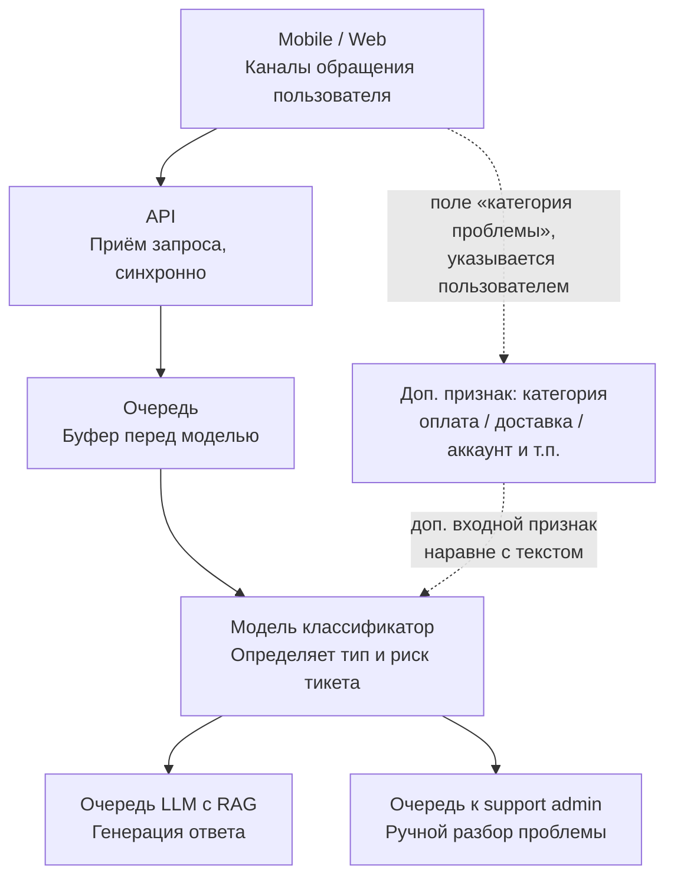

# Архитектура (черновик)

С фронта (веб/приложение) вместе с текстом тикета приходит поле «категория проблемы» — пользователь сам указывает, к чему относится обращение (оплата, доставка, аккаунт и т.п.). Это дополнительный признак на входе классификатора, наравне с текстом тикета, а не замена самой классификации: финальную категорию и риск определяет модель и они могут отличаться от значения, указанного пользователем.
